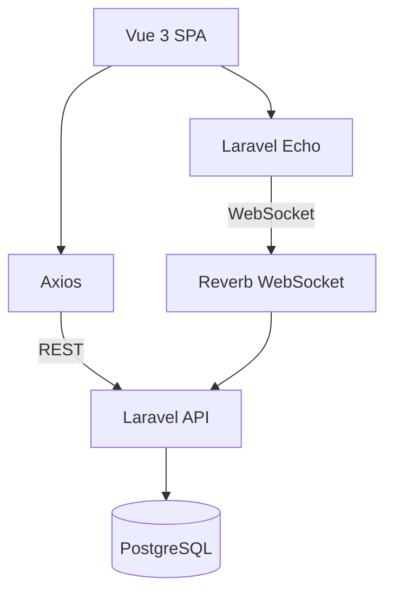
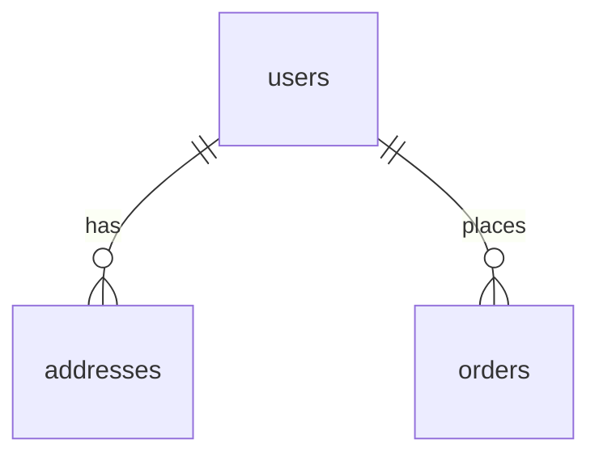
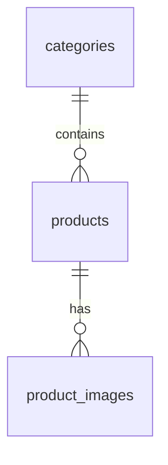
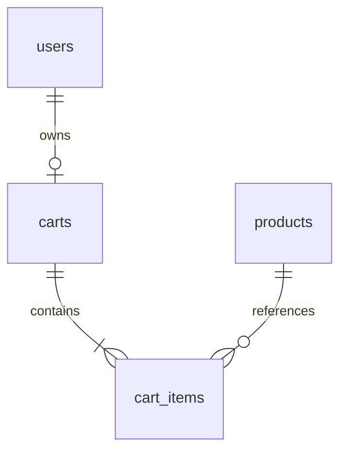
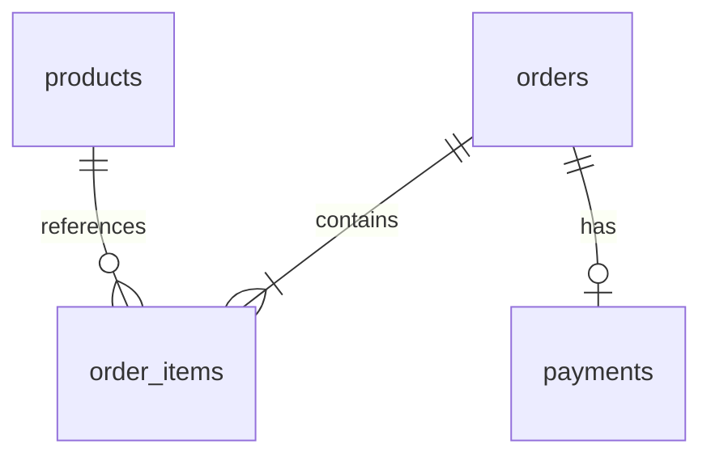

# Shoppingball

Laravel과 Vue 3로 만드는 **풀스택 쇼핑몰 클론** 프로젝트입니다.  
REST API 백엔드 + SPA 프론트엔드 구조이며, PostgreSQL·Laravel Reverb 실시간 통신까지 로컬 개발 환경을 갖추고 있습니다.

---

## Tech Stack

| 구분 | 기술 |
| --- | --- |
| **Backend** | Laravel 13, PHP 8.3+ |
| **Database** | PostgreSQL (HeidiSQL 등 클라이언트 사용) |
| **Realtime** | Laravel Reverb, Laravel Echo, Pusher-js |
| **Frontend** | Vue 3 (Composition API), Vite, Vue Router 4, Pinia |
| **Styling** | Tailwind CSS v4 (`@tailwindcss/vite`) |
| **HTTP** | Axios |

---

## System Overview

Vue SPA는 **HTTP(Axios)** 와 **실시간(Echo)** 을 각각 다른 경로로 사용합니다. 한 노드에서 두 라벨을 붙이면 GitHub Mermaid에서 선·글자가 겹칠 수 있어, 클라이언트 라이브러리를 분리해 표시합니다.



### 데이터 도메인 (요약)

| 도메인 | 주요 테이블 (개념) | 설명 |
| --- | --- | --- |
| **인증·회원** | `users`, `sessions` | 로그인, 세션 |
| **상품** | `categories`, `products`, … | 카테고리·상품·이미지 |
| **장바구니** | `carts`, `cart_items` | 비회원/회원 장바구니 |
| **주문·결제** | `orders`, `order_items`, … | 주문 생성·상태·결제 |
| **인프라** | `jobs`, `cache`, … | Laravel 기본 큐·캐시 |

마이그레이션이 추가되면 위 표의 테이블 이름만 맞춰 갱신하면 됩니다.

### 도메인별 ERD (관계만 표시)

엔티티 **이름과 관계**만 넣었습니다.

**회원 · 주소**



**상품**



**장바구니**



**주문**



<details>
<summary>컬럼·전체 ERD가 필요할 때</summary>

- DB 툴(HeidiSQL 등)에서 **역공학 다이어그램**을 쓰거나, `php artisan schema:dump` 후 팀 내부 문서에 두는 편이 README보다 낫습니다.
- Mermaid에 컬럼을 모두 넣으면 GitHub 렌더링이 깨지고 스크롤이 길어집니다. 꼭 코드로 관리하려면 **도메인마다 파일을 나누고** (`docs/erd-auth.md` 등) README에서는 위 요약만 링크하세요.

</details>

---

## Getting Started

로컬에서 프로젝트를 받아 실행하는 순서입니다.

### 1. 저장소 클론 · 백엔드

```bash
git clone https://github.com/<본인-깃허브-이름>/Shoppingball.git
cd Shoppingball

composer install

cp .env.example .env   # Windows: copy .env.example .env
php artisan key:generate
```

### 2. 데이터베이스 · 환경 변수

1. PostgreSQL에 `shopping_mall`(또는 `.env`에 맞는 이름) **빈 DB**를 만듭니다.
2. `.env`에서 아래 항목을 환경에 맞게 수정합니다.

```env
DB_CONNECTION=pgsql
DB_HOST=127.0.0.1
DB_PORT=5432
DB_DATABASE=shopping_mall
DB_USERNAME=postgres
DB_PASSWORD=본인의_DB_비밀번호

BROADCAST_CONNECTION=reverb

REVERB_APP_ID=자동생성된_ID
REVERB_APP_KEY=자동생성된_KEY
REVERB_APP_SECRET=자동생성된_SECRET
REVERB_HOST="localhost"
REVERB_PORT=8080
REVERB_SCHEME=http

VITE_REVERB_APP_KEY="${REVERB_APP_KEY}"
VITE_REVERB_HOST="${REVERB_HOST}"
VITE_REVERB_PORT="${REVERB_PORT}"
VITE_REVERB_SCHEME="${REVERB_SCHEME}"
```

### 3. 마이그레이션

```bash
php artisan config:clear
php artisan migrate
```

### 4. 프론트엔드 패키지

```bash
npm install
```

---

## Running the Application

개발 시 **터미널 3개**를 사용합니다.

| 터미널 | 명령 | 역할 |
| --- | --- | --- |
| 1 | `php artisan serve` | API (기본 `http://127.0.0.1:8000`) |
| 2 | `npm run dev` | Vite · HMR |
| 3 | `php artisan reverb:start` | WebSocket (`REVERB_PORT`, 기본 8080) |

브라우저에서는 Vite가 안내하는 주소(보통 `http://localhost:5173`)로 접속합니다.

---

